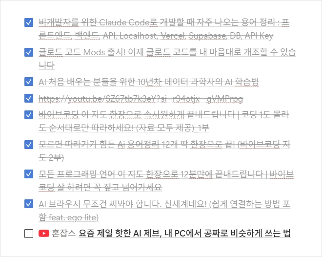
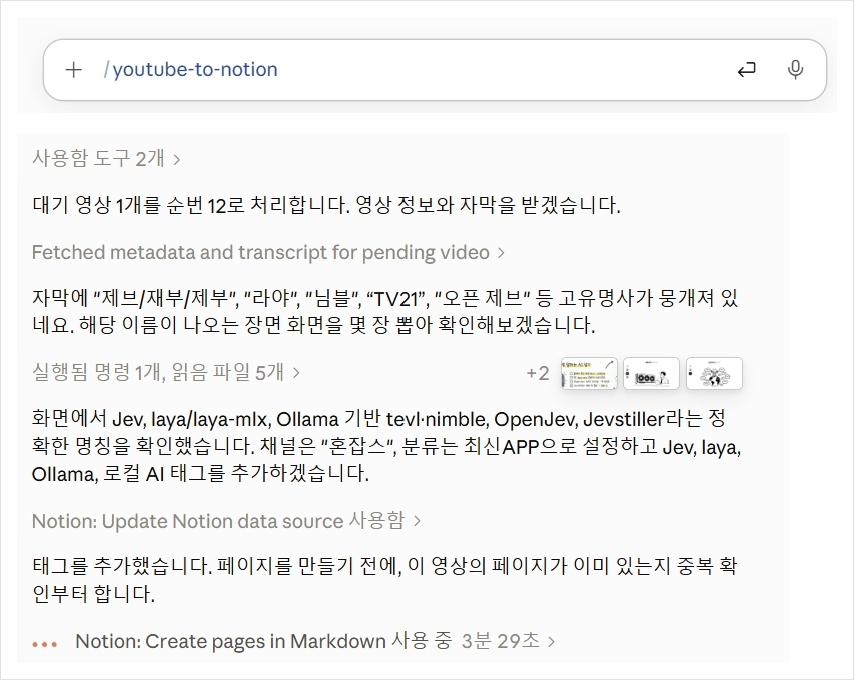
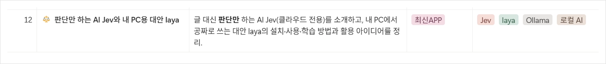
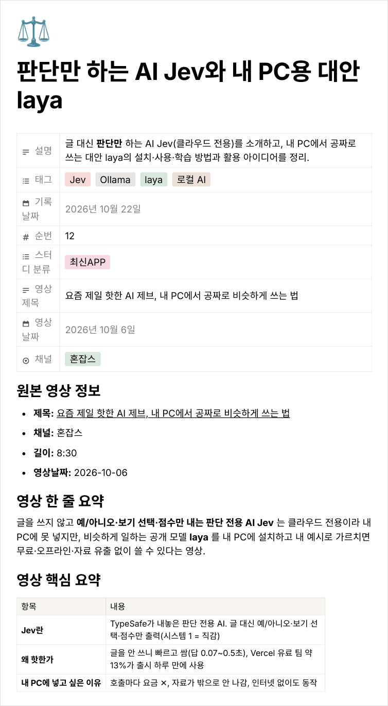

[한국어](README.md) | **English**

# youtube-to-notion

> A Claude Code skill: queue YouTube links on a Notion page, run `/youtube-to-notion`, and each video gets summarized into its own page in a Notion database.

- Uses captions when available; **transcribes with Groq Whisper when there are none**.
- One Notion page per video: thumbnail, video info, one-line summary, key-points table, section-by-section notes, and a structure tree.
- Reuses existing channel / tag / category options and adds new ones when needed.
- Processed links are checked off (`- [x]`) in the '작업 대기 영상(URL)' page; failed videos are retried on the next run.

> Note: the skill instructions and the generated summaries are in **Korean**. To get summaries in another language, edit the "한국어로 작성" (write in Korean) line in `SKILL.md`.

## 💡 Background

In today's fast-paced IT landscape, new services, applications, plugins, skills, and methodologies emerge constantly. To keep up with these changes, I often watch IT-related YouTube videos during my daily commute.

While the information feels fresh and useful at the time, I often find myself forgetting the details just a few days later — sometimes even the names of the tools or services I wanted to try. Although YouTube's Watch Later playlist and other bookmarking features make it easy to save videos, revisiting them and reviewing what I've learned can be challenging.

I wanted a way to go beyond simply saving videos: a personal learning environment where I could organize key takeaways and revisit them whenever needed.

## 🎯 The Solution

To address this challenge, I built `youtube-to-notion`, a custom skill for Claude Code.

I use Notion as a centralized video queue for YouTube URLs, making it easy to save videos on the go from my phone. When I run the `/youtube-to-notion` skill in Claude Code on my laptop, it automatically identifies unprocessed URLs, analyzes each video's subtitles (or a speech-to-text transcript when there are none) and visual content, and generates a structured summary in a new Notion page.

This turns a simple collection of video links into an organized, searchable knowledge base.

## 🚀 Benefits

- **Organized Learning Materials**: Keep YouTube videos and their key takeaways organized in one place.
- **Continuous Learning**: Revisit important concepts, practical tips, and tool usage instructions whenever needed.
- **Automated Note-Taking**: Reduce the time and effort required to summarize videos and create notes manually.
- **Long-Term Knowledge Building**: Gradually build a personal knowledge base of IT trends, tools, and techniques.

The goal is to move beyond passive video consumption and build a personalized learning workflow that helps me capture, retain, and reuse valuable knowledge over time.

## 📸 Example

**① Queue video links** — On the go, paste links into the Notion '작업 대기 영상(URL)' (video queue) page from your phone. Unchecked items are the ones to process.



**② Run one command on your laptop** — Type `/youtube-to-notion` in Claude Code. It fetches captions (or a speech-to-text transcript), checks just the relevant frames when a tool or person name is unclear, then summarizes.



**③ Organized in the database** — A new row with sequence number, description, category and tags is added at the bottom, and the processed link is checked off.




**④ Result page** — Video info, one-line summary, key-points table, section notes and a structure tree on one page.

<details>
<summary>Result page preview (click)</summary>


</details>

> Screenshots are from the Korean setup.

## How it works

```
Notion '작업 대기 영상(URL)' (video queue) page (- [ ] YouTube link)
  → /youtube-to-notion
  → watch skill (yt-dlp + ffmpeg): captions + metadata, Groq Whisper if no captions
  → write summary, pick channel / tags / category
  → new page in the Notion DB (sequence number +1)
  → check off the line in the '작업 대기 영상(URL)' page
```

## Requirements

| Item | Notes |
|------|-------|
| [Claude Code](https://claude.com/claude-code) | Runs the skill |
| Notion connector | Connect Notion in the Claude app |
| [watch skill](https://github.com/bradautomates/claude-video) | **Required dependency** for download, captions and transcription |
| yt-dlp, ffmpeg | Used by watch (Windows: `winget install yt-dlp.yt-dlp`, `winget install Gyan.FFmpeg`) |
| Groq API key (optional) | For videos without captions; otherwise frames only |

## Install

Two lines in Claude Code (Claude Code 2.1.275 or later):

```
/plugin install watch --marketplace bradautomates/claude-video
/plugin install youtube-to-notion --marketplace rsohyun/youtube-to-notion
```

- The first line installs the required [watch skill](https://github.com/bradautomates/claude-video). Follow its setup to get yt-dlp and ffmpeg.
- **(Optional) Groq key** for videos without captions: create one at [console.groq.com/keys](https://console.groq.com/keys) and put it after `GROQ_API_KEY=` in `~/.config/watch/.env`. **Never paste the key into chat or commit it.**

<details>
<summary>Manual install (without plugins)</summary>

Copy `skills/youtube-to-notion/SKILL.md` to `~/.claude/skills/youtube-to-notion/SKILL.md` (everywhere) or `<project>/.claude/skills/youtube-to-notion/SKILL.md` (one project).
</details>

## Notion setup

**Nothing to create in advance.** On the first `/youtube-to-notion` run, Claude asks:

- **Don't have them yet** → it creates an **'작업 대기 영상(URL)' (video queue) page** and a **database** (properties below + a view sorted by sequence number) under a Notion page you choose.
- **Already have them** → share both links; it connects them and adds any missing properties.

Settings are saved to `~/.config/youtube-to-notion/config.json`, so it won't ask again.

Then queue links on the '작업 대기 영상(URL)' page as a checklist:

```
- [ ] [Video title](https://youtu.be/...)
```

<details>
<summary>Database properties (reference — created automatically)</summary>

| Property | Type | Meaning |
|----------|------|---------|
| 이름 | Title | Short topic name |
| 순번 | Number | Auto-incrementing sequence (sort key) |
| 영상 제목 | Text | Original video title |
| 채널 | Select | YouTube channel |
| 설명 | Text | One-line description |
| 태그 | Multi-select | Tools / features / people in the video |
| 기록날짜 | Date | Date recorded |
| 영상날짜 | Date | Upload date |
| 스터디 분류 | Multi-select | Category (new ones added as needed) |
</details>

## Usage

In Claude Code:

```
/youtube-to-notion
```

(It may appear as `/youtube-to-notion:youtube-to-notion` when installed as a plugin.) You get a list of successes / failures with links to the new pages.

## Notes

- One failed video doesn't stop the rest.
- For videos without captions, audio is sent to Groq's servers.
- Very long videos may hit Groq's upload size limit.

## Acknowledgements

Video download, frame extraction and transcription are handled by the **[watch skill (claude-video)](https://github.com/bradautomates/claude-video)** by [bradautomates](https://github.com/bradautomates) (MIT). Its code is not included in this repository; install it separately.

## License

[MIT](LICENSE)
